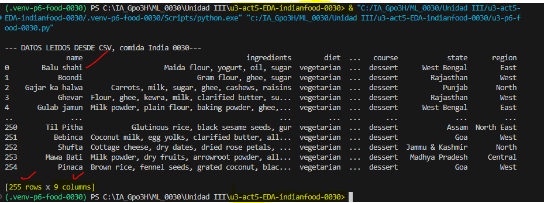
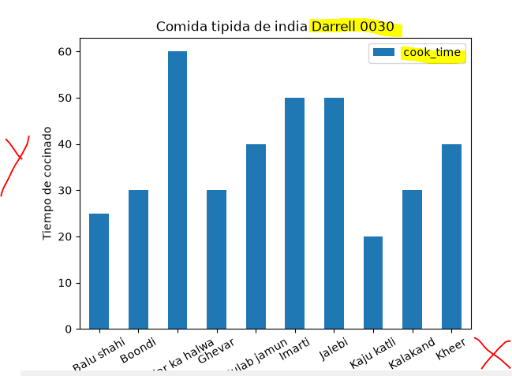
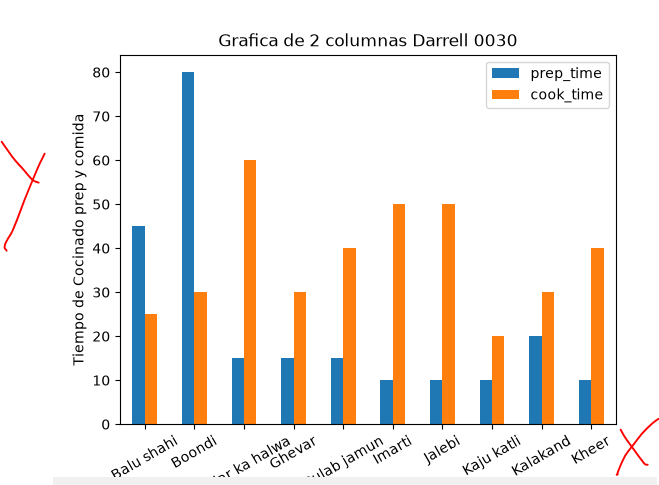
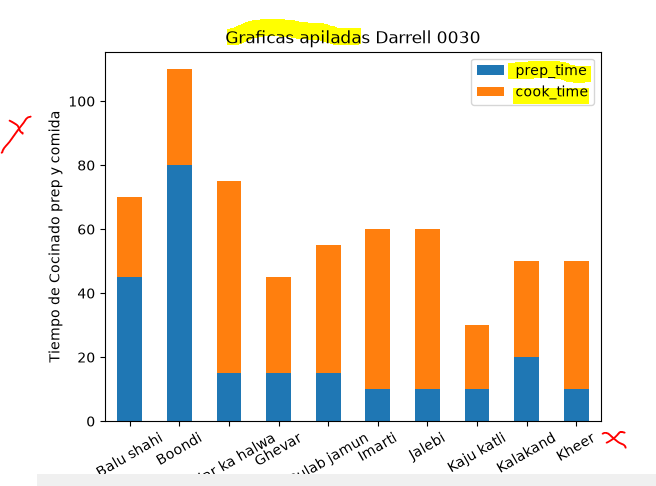

## Analisis exploratorio de datos
## Comida del pais India
## Cepeda Darrekk NC 0030
### *-*-*- Importando datos del csv comida de india 0030 -*-*-*

### *-*-*- Mostrar Nombre de la Comida + Ingredientes 0030 -*-*-*

### *-*-*- Tiempo de cocinado mostrar 10 registros con head 0030 -*-*-*

## *-*-*- Creación de gráficos de barras 0030 -*-*-*

## *-*-*- Graficas multiples -*-*-*

## *-*-*- Graficas apiladas -*-*-*
